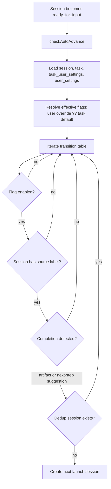

# Auto-Advance System

Auto-advance launches the next RPI session when a completed session reaches `ready_for_input` and the relevant task/user setting is enabled. The current model is transition-table driven, with workflow-specific UI visibility and task timing deciding whether a plan flows through a deferred worktree session or directly to implementation.

## Main Components

- `apps/riptide-api/src/orpc/daemon/sessions/check-auto-advance.ts` is the backend engine.
- `apps/riptide-ui/src/lib/workflow-auto-advance.ts` decides which task-sidebar toggles are visible.
- `apps/riptide-ui/src/components/sidebar-widget/SidebarWidgetAutoAdvance.tsx` renders the switches.
- `apps/riptide-ui/src/routes/_app/tasks/$taskId.tsx` wires task settings, labels, and update handlers.
- Task defaults live on `tasks`; per-user overrides live on `task_user_settings` and win when present.

## Backend Flow

## Transition Table

| Flag | Source label | Default destination | Skill |
| --- | --- | --- | --- |
| `auto_advance_questions_to_research` | `rpi:research-questions` | `rpi:research` | `rpi:create-research` |
| `auto_advance_research_to_design` | `rpi:research` | `rpi:design` | `rpi:create-design-discussion` |
| `auto_advance_plan_to_worktree` | `rpi:plan` | `rpi:worktree-setup` | `rpi:setup-worktree` |
| `auto_advance_worktree_to_implementation` | `rpi:worktree-setup` | `rpi:implementation` | `rpi:implement-plan` |
| `auto_advance_implementation_to_pr` | `rpi:implementation` | `rpi:describe-pr` | `rpi:describe-pr` |

## Plan Auto-Advance Semantics

`auto_advance_plan_to_worktree` is the legacy persisted field, but product semantics are now “auto-advance after plan.” The actual destination depends on `tasks.worktree_timing`:

- `later`: keep the default `Plan -> Worktree` behavior and launch `/rpi:setup-worktree`.
- `now`: the worktree already exists, so route `Plan -> Implementation` and launch `/rpi:implement-plan`.
- `never`: no worktree exists, so route `Plan -> Implementation` and launch `/rpi:implement-plan`.

The backend implements this with `maybeOverrideAutoAdvanceTransitionFromTaskWorktreeTiming()`, which only overrides the plan transition for `now` or `never`.

## UI Visibility

`getVisibleAutoAdvanceToggles(workflowType, worktreeTiming)` intentionally shows only toggles that can apply to the selected workflow:

- Any guided workflow shows `Implementation -> PR`.
- `rpi` shows the plan auto-advance toggle for all timings.
- `rpi + later` also shows `Worktree -> Implementation`.
- `outline_only + later` and `prd_tdd + later` show `Worktree -> Implementation`, but not plan auto-advance because they have no plan phase.
- `oneshot` only shows `Implementation -> PR`.
- `null` workflow hides workflow-specific toggles.

For `rpi + now/never`, the UI label is dynamic: it shows `Plan -> Implementation` even though the persisted setting is still named `auto_advance_plan_to_worktree`.

## Completion and Dedup

- Artifact-based transitions check for a matching artifact frontmatter `type` on the task.
- Extraction-based transitions read `next_step_suggestions` and can preserve a suggested directory.
- Before launching, the engine checks for an existing session with the destination dedup label to avoid duplicate auto-launches.

## Important Gotchas

- User-specific task settings override task-level defaults for the session creator.
- The task sidebar hides toggles by omitting change handlers, not by disabling switches.
- The historical `auto_advance_plan_to_worktree` name is intentionally not renamed at the DB layer yet.
- `worktree_timing` affects the destination of plan auto-advance, not whether the plan flag is stored.
