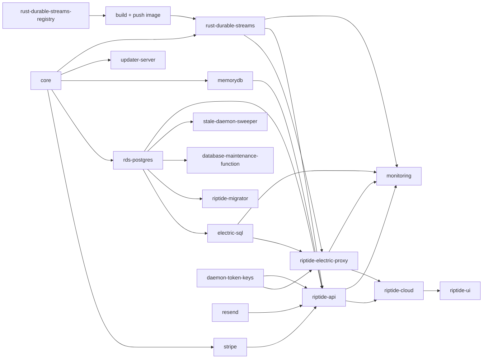

# Self-host HumanLayer

HumanLayer runs its cloud on AWS. Pulumi defines the infrastructure as a set of small stacks, and GitHub Actions deploys them in a fixed order. That deploy code lives in a private repo. This skill holds a **reference copy** of it:

- `references/pulumi-infra/<project>/` and `references/deploy/<project>/`: Pulumi programs with example stack files `Pulumi.dev.yaml` and `Pulumi.prod.yaml`. The programs are copied verbatim except for two changes. `monitoring` is cut down to a template. `core` no longer adopts log groups that already existed in HumanLayer's AWS accounts; it creates them instead.
- `references/workflows/`: the GitHub Actions workflows that deploy, build and release, copied verbatim. `references/workflows/actions/` holds the two composite actions they call.
- `references/secrets.md`: every placeholder: what it is, where to get it, which stack takes it.
- `references/build-config.md`: build-time inputs for the web apps, desktop apps and CLI, plus signing and publishing secrets.

Copied from the private deploy repo at commit `db59229ad04c541cb080fd59695040a1e3f5b727` (2026-11-13). The copy is not kept in sync and may lag `main`.

**This is a reference, not a supported deploy path.** HumanLayer does not test these files outside its own accounts. Read them, take what you need, and wire them up the way you want: Pulumi as-is, a different IaC tool, or Kubernetes.

## You WILL need to customize

These files will not deploy as-is. Work through every item below before running `pulumi up`.

### 1. Replace every placeholder

Every secret and every HumanLayer-owned value (account IDs, domains, client IDs, Sentry DSNs, PostHog keys, Slack IDs) has become `PLACEHOLDER_<NAME>_PLACEHOLDER`. This applies to the YAML, the workflows, and a few programs. Find them all with:

```bash
grep -rn "PLACEHOLDER_" .claude/skills/self-host-humanlayer/references
```

- Lines marked `# secret:` must be set with `pulumi config set --secret <key> <value>`. Pulumi then writes encrypted ciphertext into the stack file. Never commit a secret as plain text.
- Set the other values with `pulumi config set <key> <value>`, or by editing the YAML.
- `references/secrets.md` explains each one.

### 2. Edit the code that placeholders can't fix

- **Pulumi org name.** Every program finds its dependencies with `new pulumi.StackReference(\`humanlayer/<project>/${env}\`)`. Either name your Pulumi org `humanlayer`, or find-and-replace `humanlayer/` in every `StackReference` and in the workflows' `stack:` inputs and `pulumi stack output --stack` calls. On a self-managed backend (S3 or local), the org is `organization`.
- **`humanlayer/resend/prod`.** `deploy/riptide-api/pulumi.ts` always reads the `resend` stack's `prod` stage, whatever stage riptide-api itself runs as. You only need one resend stack, or change the reference.
- **`pulumi-infra/monitoring/pulumi.ts`.** It's a cut-down template: no Slack unless `slackChannelId` and `slackWorkspaceId` are set, and GuardDuty only if `guarddutyDetectorId` is set. That ID imports an existing detector; it does not create one. Alarms go to core's SNS topic (`alarmTopicArn`). Subscribe whatever alerting you use.
- **`pulumi-infra/resend/`.** The onboarding emails in `onboarding-templates.ts` and `onboarding-automation.ts` are HumanLayer's, signed by a founder. Rewrite or delete them.
- **Resource names** start with `codelayer-` (VPC, ECS cluster). Harmless, but rename them if you like.
- **`package.json` versions.** The copies use `"@humanlayer/pulumi-helpers": "workspace:*"` and `catalog:` versions from the private repo's root.
  - `@humanlayer/pulumi-helpers` is `packages/pulumi-helpers` in this repo.
  - `@humanlayer/pulumi-stripe` and `@humanlayer/pulumi-resend` are public on npm.
  - Pin the `@pulumi/*`, `effect` and `@types/node` versions yourself, or make the projects workspaces of this repo.
- **Paths.** The `deploy/*` programs build and package the apps in this repo. Their `bun run build` scripts and the asset paths inside `pulumi.ts` expect this repo to be cloned at `humanlayer/`, next to `deploy/` and `pulumi-infra/`. Recreate that layout, or edit the paths.

### 3. Provide your own AWS, DNS and Pulumi setup

- **AWS accounts.** Set `aws:allowedAccountIds` per stage. HumanLayer uses one account for dev and another for prod (and beta).
- **Region.** Every stack file and workflow assumes `us-east-1`.
- **DNS.** You need a public Route53 hosted zone that already exists (`core:dnsZone`); core looks it up and doesn't create it. `core:domainSuffix` sets the hostnames:

  | Hostname | Stack |
  |---|---|
  | `riptide-api.<suffix>` | riptide-api |
  | `sync.<suffix>` | riptide-electric-proxy |
  | `app.<suffix>` | riptide-ui |
  | `cloud.<suffix>` | riptide-cloud |
  | `update.<suffix>` | updater-server |

  core creates a wildcard ACM certificate for the suffix.
- **ARM64.** riptide-api, riptide-electric-proxy and rust-durable-streams run as ARM64 Fargate tasks. Their images build during `pulumi up`, so the deploy runner must be ARM64, or must cross-build.
- **Pulumi backend.** Use Pulumi Cloud, or a self-managed backend (`pulumi login s3://...`).

### 4. Produce your own images and keys

- **rust-durable-streams image.** Deploy `rust-durable-streams-registry` first. Then build the image and push it to that ECR repository at the tag in `rust-durable-streams:imageTag` (`0.3.0-r1`). Only after that, deploy `rust-durable-streams`. The `publish-rust-durable-streams-image` job in `references/workflows/main.yml` shows how.
- **Docker Hub and GHCR credentials** (`core`). core sets up ECR pull-through caches. Electric's image comes from Docker Hub through the cache.
- **Updater signing keys.** Generate a minisign key pair (`bunx @tauri-apps/cli signer generate`). Put it in `updater-signing-keys`, and use the same private key as `TAURI_SIGNING_PRIVATE_KEY_*` in the build. The public key and update endpoint are also baked into `apps/riptide-native/tauri.<channel>.conf.json` (`plugins.updater.pubkey` and `endpoints`), which currently point at HumanLayer's servers. Change both.
- **daemon-token-keys** generates its own key pair. Nothing to provide.

### 5. Register your own third-party apps

Each of these needs callback and webhook URLs on your domain. Details are in `references/secrets.md`.

- **WorkOS** (required: all login goes through it).
- **GitHub App** (repo access, PR status, webhooks).
- **Slack, Linear and Jira OAuth apps** (integrations).
- **Anthropic, OpenAI, Exa and Context7 API keys.**
- **Stripe.** Required by the programs. Billing can be turned off; see below.
- **Resend.** Bring your own key and sending domain.
- **Sentry and PostHog.** Optional. Replace HumanLayer's DSNs and keys with your own, or with empty values where the program allows it.

### 6. Adapt the workflows

The workflows are verbatim copies from a repo that differs from yours:

- **Two repos.** HumanLayer deploys from a private repo that clones this public one into `humanlayer/`. See `references/workflows/actions/checkout-public-clone/action.yml`, `PUBLIC_REPO_READ_TOKEN`, and the `public_repo` / `public_sha` inputs. With one repo, check out once and drop all of that.
- **Runners.** They use Blacksmith (`blacksmith-*`) and a self-hosted office Mac (`humanlayer-office-runner`). Use `ubuntu-latest`, `ubuntu-24.04-arm` and `macos-15`, or your own.
- **Secret names.** `DEV_CLOUD_AWS_*` and `PROD_CLOUD_AWS_*` are per-account AWS keys. You also need `PULUMI_ACCESS_TOKEN`, plus the signing and publishing secrets in `references/build-config.md`.
- **Jobs to delete.**
  - `rivet` (no longer used; also drop it from every `needs:`).
  - `admin-dashboard-api`, `bastion` and `production-debugging-access` (private, not included).
  - `docs` (prod) and the `beta` jobs in `main.yml`.
  - `deploy-live-pulumi`, `publish-linear-cli` and `publish-rpi-cli` in `main.yml`, whose workflows aren't included.
- **Publishing targets.** The desktop release publishes to the `humanlayer/homebrew-humanlayer` tap, and the CLI publishes to npm as `@humanlayer/cli`. Point these at your own tap and npm scope, or remove them.

### 7. Turn billing off (or set up Stripe)

riptide-api, riptide-ui and riptide-cloud read outputs from the `stripe` stack, so the stack must exist. To run without billing:

- Set `stripe:billingEnforcementEnabled: false` in your stripe stack files.
- Set `stripe:mode: testing` and use a Stripe **test-mode** secret key. The stack still creates products, prices and a webhook in that test account, but billing gates stay off.
- riptide-ui reads `billingEnforcementEnabled` from the stack and builds with `VITE_PUBLIC_BILLING_ENFORCEMENT_ENABLED` to match.

## Singletons: Electric and durable streams

**Run exactly one electric-sql task and one rust-durable-streams task. During a deploy, never let an old and a new task run at the same time.** Both keep state on local disk and can't share it.

- rust-durable-streams already does this: `desiredCount = 1`, `deploymentMinimumHealthyPercent: 0`, `deploymentMaximumPercent: 100` (`references/pulumi-infra/rust-durable-streams/pulumi.ts:176-180`).
- electric-sql takes `desiredCount` from config. Keep it at `1`.

HumanLayer runs both on **Fargate ephemeral storage**, so each restart or deploy starts from an empty disk. We accept that cost. **We recommend persistent block storage instead.** For example, run each as a Kubernetes StatefulSet with `replicas: 1` and an EBS-backed PersistentVolumeClaim, or as an ECS task on EC2 with an attached EBS volume. **Don't use EFS or NFS**: both services want fast local disk.

What a restart costs on ephemeral storage:

- **Electric: no data loss.** Postgres is the source of truth. Electric rebuilds its shape cache from Postgres and clients re-sync. Expect a slow, heavy cold start.
- **Durable streams: mostly a reconnect, with some real loss.** Postgres stays the source of truth for saved data.
  - Session streams refill from `conversation_events` the next time a client asks for them (`apps/riptide-api/src/effects/services/durable-streams/streams.ts`).
  - PR status refills from GitHub within about 30 seconds.
  - Task diffs rebuild on the daemon's next capture.
  - **Lost for good:**
    - token-by-token output that was mid-stream
    - response-editor drafts that nobody has open
    - diff version history and review marks on old versions
    - diffs for tasks whose daemon is offline
  - Open session pages stop live streaming until reloaded. Saved events still arrive through Electric.
  - Expect about 30–90 seconds of no streaming per deploy, since old and new tasks never overlap.
  - Not verified: after a wipe, a daemon that was streaming may stop live streaming for the rest of that run. Its events still save to Postgres.

## Services

| Stack | Path | Creates | Reads from |
|---|---|---|---|
| core | `pulumi-infra/core` | VPC, ECS cluster, Route53 zone lookup, wildcard ACM cert, SNS alarm topic, Cloud Map namespace, ECR pull-through caches | none |
| daemon-token-keys | `pulumi-infra/daemon-token-keys` | Key pair for daemon auth tokens, in Secrets Manager | none |
| updater-signing-keys | `pulumi-infra/updater-signing-keys` | Your minisign key pair, in Secrets Manager | none |
| rust-durable-streams-registry | `pulumi-infra/rust-durable-streams-registry` | ECR repository for the durable streams image | none |
| resend | `pulumi-infra/resend` | Resend sending domain and DNS, segments, onboarding emails | none (Route53 zone directly) |
| stripe | `pulumi-infra/stripe` | Stripe products, prices, webhook; keys in Secrets Manager | core |
| rds-postgres | `pulumi-infra/rds-postgres` | Postgres 18 primary and read replica, connection URLs in Secrets Manager | core |
| memorydb | `pulumi-infra/memorydb` | MemoryDB (Redis) cluster | core |
| rust-durable-streams | `pulumi-infra/rust-durable-streams` | Singleton durable streams server on Fargate, behind an internal ALB | core, rust-durable-streams-registry |
| electric-sql | `pulumi-infra/electric-sql` | Singleton Electric sync server on Fargate | core, rds-postgres |
| riptide-migrator | `deploy/riptide-migrator` | Lambda that runs database migrations; invoked on every deploy | core, rds-postgres |
| database-maintenance-function | `deploy/database-maintenance-function` | Scheduled database maintenance Lambda | core, rds-postgres |
| stale-daemon-sweeper | `deploy/stale-daemon-sweeper` | Scheduled Lambda that cleans up stale daemons, expired hosts and lost sessions | core, rds-postgres |
| updater-server | `deploy/updater-server` | S3 + CloudFront + Lambda serving desktop app updates at `update.<suffix>` | core |
| riptide-electric-proxy | `deploy/riptide-electric-proxy` | Auth proxy for Electric and durable streams on Fargate at `sync.<suffix>` | core, rds-postgres, electric-sql, daemon-token-keys, rust-durable-streams |
| riptide-api | `deploy/riptide-api` | The API on Fargate at `riptide-api.<suffix>`, artifacts bucket, app secrets | core, rds-postgres, daemon-token-keys, stripe, memorydb, rust-durable-streams, resend (prod) |
| riptide-cloud | `deploy/riptide-cloud` | Web app (admin, install) on S3 + CloudFront at `cloud.<suffix>` | core, riptide-api, riptide-electric-proxy, stripe |
| riptide-ui | `deploy/riptide-ui` | Main web app on S3 + CloudFront at `app.<suffix>` | core, riptide-api, riptide-electric-proxy, riptide-cloud, stripe |
| monitoring | `pulumi-infra/monitoring` | CloudWatch alarms and ECS event capture (template) | core, electric-sql, riptide-api, riptide-electric-proxy, rust-durable-streams |

The daemon (`apps/riptide-daemon`) is not a cloud service. It ships inside the CLI (`apps/cli`) and runs on each user's machine. Build it with your own API and sync URLs; see `references/build-config.md`.

## Deploy order



As levels (stacks in one level can deploy at the same time):

1. core, daemon-token-keys, updater-signing-keys, rust-durable-streams-registry, resend
2. stripe, rds-postgres, memorydb, updater-server. Build and push the durable streams image, then deploy rust-durable-streams.
3. electric-sql, riptide-migrator, database-maintenance-function, stale-daemon-sweeper
4. riptide-electric-proxy, riptide-api
5. riptide-cloud, then monitoring
6. riptide-ui

Two differences from HumanLayer's workflows:

- **riptide-ui must come after riptide-cloud.** riptide-ui reads `cloudUrl` from the riptide-cloud stack, but `pulumi-deploy-dev.yml` and `pulumi-deploy-prod.yml` run them side by side. That only works because our riptide-cloud stacks already exist. On a fresh setup, deploy riptide-cloud first.
- **resend isn't in any workflow.** HumanLayer deploys it by hand, once. Do the same before riptide-api.

Each step is `pulumi up --stack <org>/<project>/<stage>` from the project folder. Projects under `deploy/` that package Lambdas (riptide-migrator, database-maintenance-function, stale-daemon-sweeper, updater-server) need `bun run build` first; see `pre-command` in the workflows. `references/workflows/pulumi-deploy-project.yml` shows the full per-stack job.

## Build and release

The workflows in `references/workflows/`:

- **`main.yml`**: runs after CI passes on `main`. It publishes the durable streams image, then calls `release-riptide-dev.yml`, which deploys dev Pulumi and builds and publishes the dev desktop builds. It also publishes the CLI when its version changes.
- **`pulumi-deploy-dev.yml` and `pulumi-deploy-prod.yml`**: the full stack graph above, one `pulumi-deploy-project.yml` call per stack.
- **`release-riptide-dev.yml` and `release-riptide-prod.yml`**: build and sign the Tauri desktop app, deploy Pulumi, deploy updater-server, then upload the update to the updater bucket and publish a GitHub release and Homebrew cask. They also build and publish Electron, and prod also publishes the CLI.
- **`release-riptide-tauri-dev-build.yml`, `release-riptide-electron-dev-build.yml` and `release-riptide-electron-dev-publish.yml`**: the desktop build and publish steps they call.
- **`release-humanlayer-cli.yml`**: builds the CLI with the daemon inside, for every platform. It reads API, sync, cloud and app URLs from the Pulumi stack outputs, then publishes to npm.
- **`resolve-public-sha.yml`**: turns a branch or tag into one SHA, so every job builds the same commit.

Releases read stack outputs (`pulumi stack output serviceUrl --stack .../riptide-api/<stage>`, etc.), so deploy a stage before you release against it. Every build-time input and signing secret is listed in `references/build-config.md`.

## When helping someone self-host

1. Ask which parts they want: the web apps only, or also desktop apps and the CLI. Web-only users can skip updater-server, updater-signing-keys and the desktop release workflows. They still need their own CLI build: the CLI bakes in its API, sync, cloud and app URLs and WorkOS client ID at build time.
2. Ask how they want to run it: these Pulumi programs on AWS, or another platform using them as a guide. For Kubernetes, map each Fargate service to a Deployment and each singleton to a `replicas: 1` StatefulSet with EBS.
3. Go through the "You WILL need to customize" list with them in order. Don't skip items 1 and 2: nothing deploys until they're done.
4. Deploy in the order above, one stage at a time, starting with dev.
