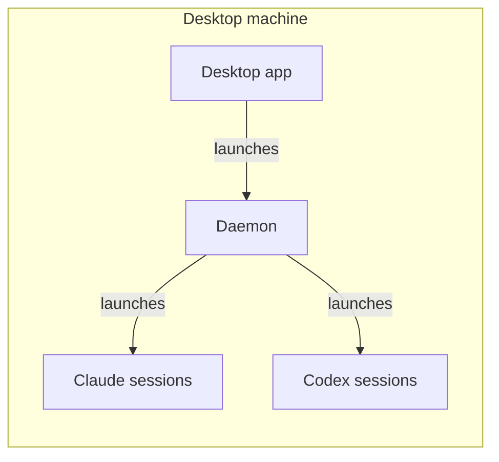
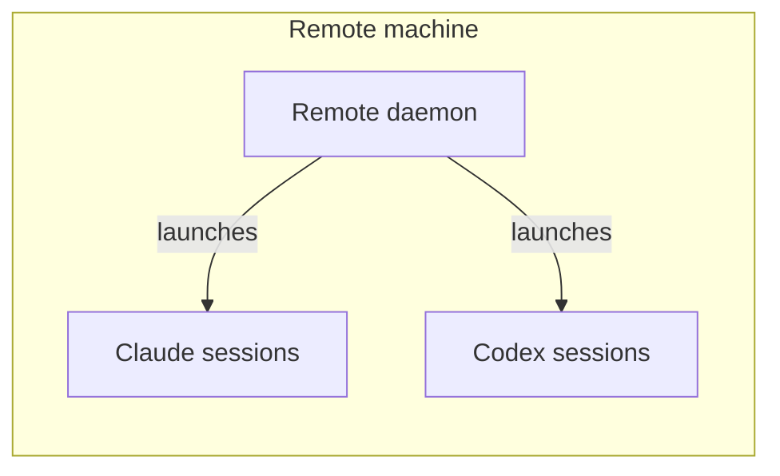
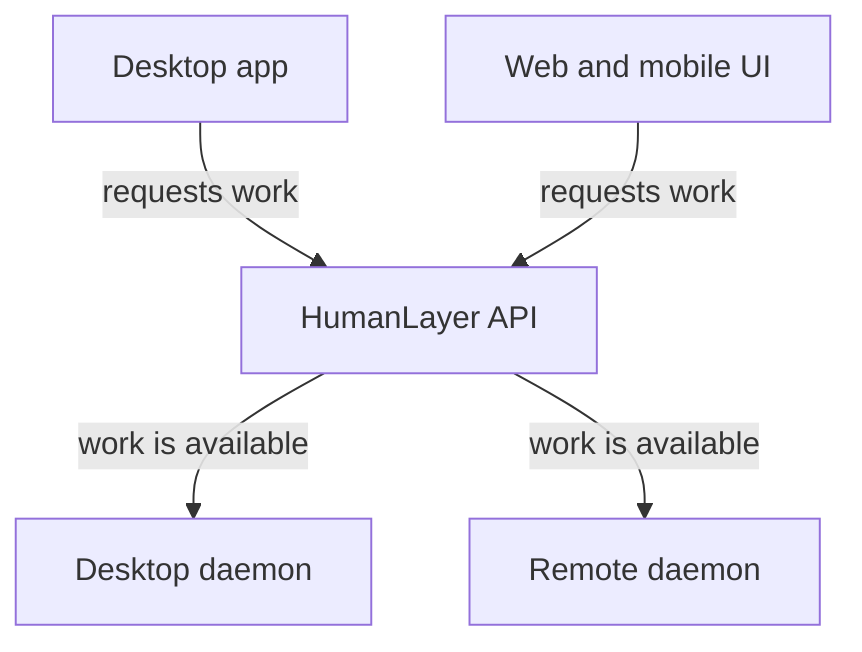
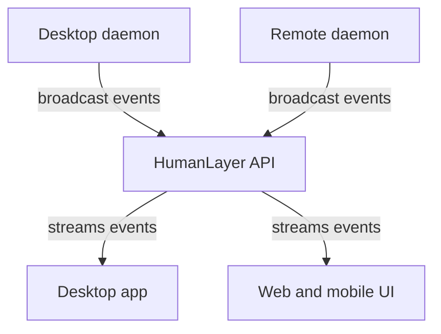

# How Remote Daemons Work

A remote daemon runs HumanLayer coding sessions on a host that you select. You control the sessions from app.humanlayer.com, but the daemon host does the work.

Use the [remote daemon guide](/guide/remote-daemons) when you are ready to install and launch a daemon.

### Where sessions run

#### Desktop app

The desktop app starts a daemon on the same machine, and that daemon launches Claude or Codex sessions.



#### Remote daemon

A remote daemon launches Claude or Codex sessions on its own machine without the desktop app.



### How work and events move

The API sends work to either daemon type. Daemons send session events back through the API to each interface.

#### Starting work

The desktop app or the web and mobile UI requests work through the API, which makes the work available to a connected daemon.



#### Receiving events

Each daemon sends broadcast events to the API, which streams them to the desktop app and the web and mobile UI.



## Daemon hosts

The host can be a cloud VM, workstation, or private-network machine. Select a host that can access the code, tools, credentials, and private services that the agent needs.

The daemon makes these host resources available to HumanLayer sessions. This design lets you use the browser app while work runs on a more powerful host. It also lets sessions run near private infrastructure that your laptop cannot reach.

You can use a daemon as a repeatable process on a workstation or shared development machine. Run the daemon as a user that has only the required file and network access.

## Authentication and persistence

`humanlayer login` stores a session in `~/.humanlayer/riptide/`. The session includes a refresh token. Production and beta sessions use separate files.

The CLI refreshes the session when necessary. Authentication remains available after a daemon restart or host reboot when both conditions are true:

- The daemon runs as the same user.
- The user's `~/.humanlayer/riptide/` directory remains intact.

You must log in again after you delete that directory or run `humanlayer logout`. You must also log in again if the CLI cannot refresh the saved session.

A launch token works differently. The CLI exchanges the token for credentials for one daemon process. The CLI does not save those credentials for the next launch. A restarted daemon needs another valid launch token unless you first use `humanlayer login`.

### Containers

Credentials remain available when you stop and restart the same container. The credentials are lost when you remove and recreate the container unless you mount persistent storage.

Set `HUMANLAYER_RIPTIDE_HOME` to a mounted directory. The login and daemon commands must use the same environment and volume. This Compose service fragment stores credentials in a named volume:

```yaml
services:
  daemon:
    environment:
      HUMANLAYER_RIPTIDE_HOME: /var/lib/humanlayer
    volumes:
      - humanlayer-auth:/var/lib/humanlayer

volumes:
  humanlayer-auth:
```

You can instead mount the container user's `~/.humanlayer/riptide/` directory. Treat the mounted files as credentials. Limit access to them.

If the image ships the CLI, [turn off in-app updates](/guide/remote-daemons#turn-off-in-app-updates) so the app cannot install a different version in the container.

### Disposable and suspended hosts

HumanLayer binds each session to the host that runs it. The host ID lives in `$HOME/.humanlayer/riptide/host_id`, not in `HUMANLAYER_RIPTIDE_HOME`. If a container or VM comes back without that file, the daemon registers as a new host and does not pick up the old host's sessions.

To suspend a host and resume it later, for example as a new pod with the same disk, persist these paths:

- `HUMANLAYER_RIPTIDE_HOME`, or `~/.humanlayer/riptide/`, for credentials.
- `$HOME/.humanlayer/riptide/host_id`, for the host ID.
- `~/.claude/`, because Claude Code resumes a conversation from its local history. Codex conversations are stored by HumanLayer and need no local files.

Suspend the host while its sessions wait for input. A waiting session continues after any length of suspend. If the daemon stops responding for about two minutes while a session is running or waiting for a tool approval, HumanLayer marks the session failed. You can still send it a new message after the host comes back.

### Task files and Git

The daemon links each task's files into the repository at `.humanlayer/tasks/`. If Git does not already ignore that path, the daemon adds it to the repository's `.gitignore`. To keep `.gitignore` unchanged, ignore the path another way before the daemon starts:

- Add `.humanlayer/tasks/` to `.git/info/exclude` in the repository.
- Add `.humanlayer/tasks/` to a global ignore file, such as `~/.config/git/ignore`, in the host image.

## Process life cycle

The daemon command does not manage a long-running process for you. If you start it over SSH, use systemd, `tmux`, `screen`, or another process supervisor. This keeps the daemon running after you disconnect. The [remote daemon guide](/guide/remote-daemons#keep-the-daemon-running) includes a systemd user service.

Stop the daemon when you no longer want the host to accept HumanLayer sessions.

## Network access

The daemon needs outbound HTTPS access to these hosts:

| Purpose | Production | Beta |
| --- | --- | --- |
| HumanLayer API | `riptide-api.humanlayer.com` | `riptide-api.codelayer.cloud` |
| Sync and session streams | `sync.humanlayer.com` | `sync.codelayer.cloud` |

Some features need more hosts:

| Feature | Host |
| --- | --- |
| `humanlayer login` | `api.workos.com` |
| GitHub pull requests and issues | `api.github.com`, plus your Git remotes |
| In-app daemon updates | your npm registry |
| Claude Code | the Anthropic API, Bedrock, or your gateway. Read Anthropic's [network access requirements](https://code.claude.com/docs/en/network-config). |
| Codex | `chatgpt.com` and `auth.openai.com`, or your custom endpoint |

The daemon from the npm CLI does not send error telemetry. To route model traffic through your own endpoint or proxy, read [route models through an LLM gateway](/guide/llm-gateways).

## Browser and native app capabilities

After the daemon connects, you can use [app.humanlayer.com](https://app.humanlayer.com) from a machine or phone. You can create sessions, watch their work, and send messages to the coding agent. The sessions run on the daemon host. You do not need the native app for this workflow.

The browser app does not yet provide these native app features:

- Workspace management and configuration editing.
- Embedded terminal access.
- Directory auto-complete when you select paths.

These features are planned for the browser app.

## Security model

The daemon gives coding agents the file and network access of the user that runs it. Use an account with only the access that the sessions need.

Treat launch tokens as credentials until they expire. Treat saved session files and mounted authentication volumes as credentials. Stop the daemon to prevent new HumanLayer sessions on the host.
