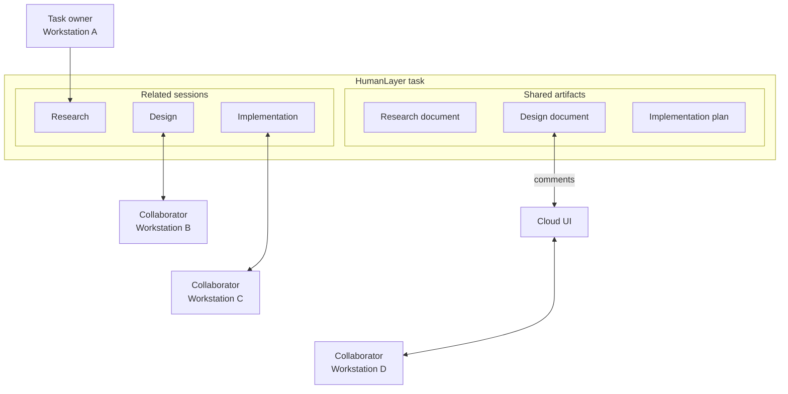

# How HumanLayer tasks keep related work together

A HumanLayer task gives one piece of work:

- A group of related sessions
- A shared set of task files
- One place for comments and review
- A history that can continue across agents and workstations

This is useful when work needs more than one agent run. Research, design, implementation, and review sessions can stay separate while they share one task.



## A task is larger than one session

A session is one conversation with a coding agent. It has its own:

- Agent and model settings
- Working directory
- Messages
- Run state

A task can contain several sessions. Each session stays separate, while the task keeps their work together. This lets you:

- Start a fresh session without losing the task history
- Use different sessions for different phases
- Ask another person or agent to continue the same work
- Review all related sessions in one place

## Share and review a task

HumanLayer shares access at the task level. When a task is shared:

- Teammates can see its related work according to their task access
- People with edit access can add sessions and update task files
- Reviewers can comment on synced documents in HumanLayer
- Agents can read that feedback in later work

This keeps the discussion with the work it describes. A reviewer does not need a separate copy of a plan or design document.

## Task files have a local and cloud form

Each task has a directory at:

```text
.humanlayer/tasks/<task-slug>/
```

HumanLayer links this path to task storage on the workstation:

- A connected daemon downloads the task's cloud files when it starts work for the task
- Cloud changes write back to the local directory while task sync is active
- Another workstation can download the same files when it runs the task
- Synced files appear in the task's artifact view

When a coding agent reads, writes, or edits a file in the current task directory with a supported file tool, HumanLayer syncs that file to the cloud. The cloud copy can then appear in the task's artifact view, where people can share and comment on it. This is task-file sync, not a backup of the repository or every file on the workstation.

## Which files sync

HumanLayer stores these file types as text artifacts:

- Markdown: `.md` and `.mdx`
- Plain text: `.txt`
- JSON: `.json` and `.jsonl`

The text artifact API limits each file's content to 10 MB.

HumanLayer uploads other file types, such as images, PDFs, and HTML, through object storage.

Sync follows agent `Read`, `Write`, `Edit`, `MultiEdit`, and `apply_patch` operations. The available tool names depend on the coding agent. A file does not upload only because another program placed it in the directory. Have the coding agent read or update the file with one of its supported file tools when you need HumanLayer to sync it.

## Why use a task

A task keeps the full body of work together:

- Related sessions stay grouped
- Documents and comments stay with the work
- People and agents can continue from the same context
- Task files can follow the work across workstations
