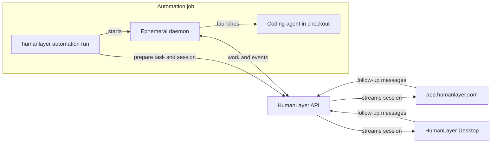

# Run HumanLayer Sessions in Automations

Use `humanlayer automation run` to run one Cloud-visible coding session from any automation environment — a CI job, a cron machine, or a script on a server. The command needs a checkout of your code and a [personal access token](#create-a-personal-access-token); it does not require an interactive HumanLayer login. This is the same setup the HumanLayer team uses for its own recurring agents, such as a scheduled agent that migrates one API procedure per day and opens a pull request with the result.

## How it works

A normal HumanLayer session runs on a daemon you keep alive — the desktop app's daemon or a [remote daemon](/guide/remote-daemons). An automation session instead brings its own daemon: the CLI starts one inside the automation job, runs a single session in the current directory, and shuts it down when the session finishes.

One command does everything:

1. The CLI calls the HumanLayer API with your token. The API creates the task if needed and prepares one session bound to a fresh host ID.
2. The CLI exchanges a short-lived launch token for daemon credentials tied to that host ID.
3. The CLI starts a daemon inside the job. The daemon picks up the prepared session and launches the coding agent in the working directory with permission prompts bypassed.
4. The daemon streams session events to HumanLayer Cloud. You can watch the session at [app.humanlayer.com](https://app.humanlayer.com) and send follow-up messages while the run is alive.
5. When the session finishes, the daemon shuts down and the command exits with a code that reflects the session result. Later automation steps can commit, push, or publish whatever the session produced.



The daemon lives only for the length of the job. It does not clone the repository and it does not need HumanLayer workspace or worktree configuration — it works directly in the job's checkout.

### Tasks and sessions

Every session belongs to a task. Automation runs reuse one task per automation, so each run adds a session under the same task in HumanLayer and you can read the automation's history in one place. `--ensure-task <slug>` creates the task on the first run and reuses it after that; `--use-task <id-or-slug>` requires a task that already exists.

## Create a personal access token

1. Open HumanLayer and select the organization that will own the automation task.
2. Go to **Settings > Account > Personal access tokens**.
3. Name the token, pick an expiration, and press **Create token**.
4. Copy the token immediately. HumanLayer cannot show its full value again.


Store the token in your automation platform's secret store. Never commit it.

## The CLI command

Run the command from the directory the agent should work in. The coding agent also needs its provider credential in the environment — `ANTHROPIC_API_KEY` for the default Claude setup.

```bash
humanlayer automation run \
  --pat "${HUMANLAYER_PAT}" \
  --ensure-task readme-greeter \
  --task-name "README greeter" \
  --session-name "Greeting run $(date +%Y-%m-%d)" \
  --metadata-file /tmp/humanlayer-run.json \
  --prompt-file automation/greeting.md
```

- `--pat` authenticates the run.
- `--ensure-task` plus `--task-name` create the task on the first run and reuse it on later runs.
- `--session-name` labels this run's session. Include something unique such as a run ID or a date.
- `--metadata-file` writes the prepared `taskId` and `sessionId` as JSON for later automation steps. Use those IDs to build canonical `/tasks/:taskId?deep=true` and `/sessions/:sessionId?deep=true` app links.
- `--prompt-file` reads the agent instructions from a file in the checkout. Use `--prompt` for short inline text.
- `--shutdown-on` controls when the daemon exits. The default `inactivity` with `--inactivity 2m` keeps the daemon up until two minutes after the last activity, so you can send Cloud follow-ups; each interaction resets the timer. Use `--shutdown-on stop` to exit as soon as the session is ready for input.
- `--provider`, `--model`, `--coding-agent`, and `--thinking` select the agent. The defaults use Claude through the Anthropic API.

## Example: GitHub Actions

GitHub Actions is the most common home for these runs: the checkout, secret store, schedule triggers, and `gh` CLI are all built in.

### Save the secrets

In the GitHub repository, go to **Settings > Secrets and variables > Actions**. Create a repository secret named `HUMANLAYER_PAT` with the one-time token value, and make sure the provider credential — here `ANTHROPIC_API_KEY` — exists as a secret too.

### A hello-world workflow

This workflow runs a session that adds a greeting to the README, then commits, pushes a new branch, and opens a pull request — all from inside the session, using the `gh` CLI with the job's `GITHUB_TOKEN`.

```yaml
name: HumanLayer hello world

on:
  workflow_dispatch:

permissions:
  contents: write
  pull-requests: write

jobs:
  hello-world:
    runs-on: ubuntu-latest
    steps:
      - uses: actions/checkout@v5
        with:
          fetch-depth: 0

      - name: Configure git user
        run: |
          git config user.name "github-actions[bot]"
          git config user.email "github-actions[bot]@users.noreply.github.com"

      - uses: oven-sh/setup-bun@v2

      - name: Run automation
        env:
          HUMANLAYER_PAT: ${{ secrets.HUMANLAYER_PAT }}
          ANTHROPIC_API_KEY: ${{ secrets.ANTHROPIC_API_KEY }}
          GH_TOKEN: ${{ secrets.GITHUB_TOKEN }}
        run: |
          cat > /tmp/prompt.md <<'EOF'
          Add a small fun greeting to the README.

          Then publish the change yourself:

          1. Create a branch named `hello-world/<today's date>`.
          2. Commit the change.
          3. Push the branch with `git push --set-upstream origin <branch>`.
          4. Open a pull request with `gh pr create --fill`.
          EOF

          bunx @humanlayer/cli@latest automation run \
            --pat "${HUMANLAYER_PAT}" \
            --ensure-task hello-world \
            --task-name "Hello world" \
            --session-name "Hello world ${GITHUB_RUN_ID}" \
            --metadata-file /tmp/humanlayer-run.json \
            --prompt-file /tmp/prompt.md
```

The `permissions` block gives `GITHUB_TOKEN` the rights the agent needs to push the branch and open the pull request. The `GH_TOKEN` variable makes that token available to `git` and `gh` inside the session.

You can also keep git orchestration out of the prompt and do it in the workflow instead. Add a step after `Run automation` that commits whatever the session changed:

```yaml
- name: Commit changes and open a pull request
  env:
    BRANCH: humanlayer/${{ github.run_id }}
    GH_TOKEN: ${{ secrets.GITHUB_TOKEN }}
  run: |
    git checkout -b "$BRANCH"
    git add -A
    git diff --cached --quiet && exit 0
    git commit -m "chore: apply HumanLayer automation"
    git push --set-upstream origin "$BRANCH"
    gh pr create --fill
```

### Growing into a recurring agent

The hello-world example is the whole mechanism. The HumanLayer team's production agents add a few workflow-level patterns on top:

- **A schedule trigger.** Add a `schedule` cron entry next to `workflow_dispatch` so the agent runs daily.
- **A no-op guard.** Before running the agent, check `gh pr list --label <agent-label>` and exit early when an open agent PR already exists. One unreviewed PR at a time keeps the queue honest.
- **A concurrency group.** Set `concurrency` on the workflow so a manual run cancels an in-flight scheduled run instead of racing it.
- **Agent memory.** Keep a markdown file such as `.github/agent-memory/<agent>.md` in the repository and include its contents in the prompt. When a run teaches you something, update the file in a PR and every later run knows it.
- **An iteration loop.** Listen for `issue_comment` events on agent PRs. When a maintainer comments `/iterate` with feedback, check out the PR branch, build a prompt from the PR discussion and the feedback, and run `automation run` again to update the same branch.
