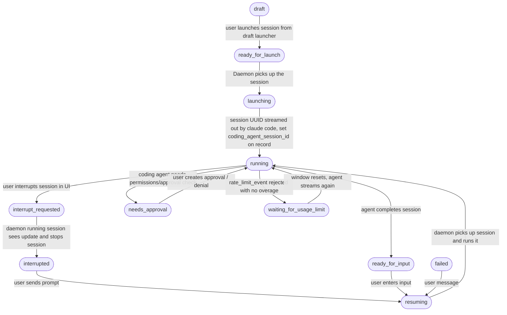

# Session State Machine

This document describes the session status state machine used in the Riptide system.

## Status Values

| Status | Description | Category |
|--------|-------------|----------|
| `draft` | Session created but not launched | Inactive |
| `ready_for_launch` | Session ready for daemon to pick up for initial launch | Pending |
| `launching` | Daemon is starting Claude Code for the first time | Active |
| `running` | Claude Code actively processing | Active |
| `ready_for_input` | Agent completed work, awaiting user input | Stable |
| `resuming` | User sent input, awaiting daemon to resume session | Pending |
| `failed` | Session encountered error, can be retried with user message | Recoverable |
| `needs_approval` | MCP tool approval needed | Waiting |
| `waiting_for_usage_limit` | Claude account hit a subscription usage limit; the agent resumes when the window resets | Waiting |
| `interrupt_requested` | User requested interrupt | Waiting |
| `interrupted` | Session was interrupted, can be resumed with user prompt | Recoverable |

## State Transition Diagram

## Transition Rules

### User-Initiated Transitions (via riptide-api)

| From | To | Trigger | Handler |
|------|-----|---------|---------|
| `null` | `draft` | Create session | `api.sessions.create` |
| `null` | `ready_for_launch` | Create and launch | `api.sessions.launch` |
| `draft` | `ready_for_launch` | Launch draft session | `api.sessions.launch` |
| `ready_for_input` | `resuming` | Continue session with user input | `api.sessions.continue` |
| `interrupted` | `resuming` | Resume interrupted session with prompt | `api.sessions.continue` |
| `failed` | `resuming` | Retry failed session with message | `api.sessions.continue` |

### Daemon-Initiated Transitions (via riptide-daemon)

| From | To | Trigger | Handler |
|------|-----|---------|---------|
| `ready_for_launch` | `launching` | Daemon picks up session | `handleLaunchSession` |
| `launching` | `running` | Claude SDK streams session UUID | `runSession` |
| `resuming` | `running` | Daemon picks up and resumes session | `handleContinueSession` |
| `running` | `ready_for_input` | Agent completes work | `runSession` |
| `running` | `needs_approval` | Agent needs permission | `runSession` |
| `needs_approval` | `running` | User approves/denies | `handleApproval` |
| `running` | `waiting_for_usage_limit` | Claude SDK emits a rejected `rate_limit_event` without overage | `processClaudeEvents` |
| `waiting_for_usage_limit` | `running` | Window resets and the agent streams again | `processClaudeEvents`, event repair in `events.create` |
| `running` | `interrupt_requested` | User requests interrupt | via Electric sync |
| `interrupt_requested` | `interrupted` | Daemon stops session | `handleInterrupt` |
| `*` | `failed` | Any error during processing | error handlers |

## Key Invariants

1. **`ready_for_launch` is for initial launch only**: A session will NEVER transition from `running` back to `ready_for_launch`
2. **Resumption requires `coding_agent_session_id`**: The `resuming` → `running` transition requires the session to have a `coding_agent_session_id` from the initial launch
3. **Multiple entry points to `resuming`**: Sessions can enter this state from `ready_for_input`, `interrupted`, or `failed`

## Source References

- Type definition: `packages/db/src/tables/sessions.ts:7-18`
- Contract validation: `contracts/riptide-api-contract/src/daemon/sessions/update.ts:9-23`
- UI styling: `apps/riptide-ui/src/components/session-table/types.ts:1-13`
- Daemon handler: `apps/riptide-daemon/src/handlers/sessions/on-session-continue.ts`
- API handler: `apps/riptide-api/src/orpc/api/sessions/continue.ts`
