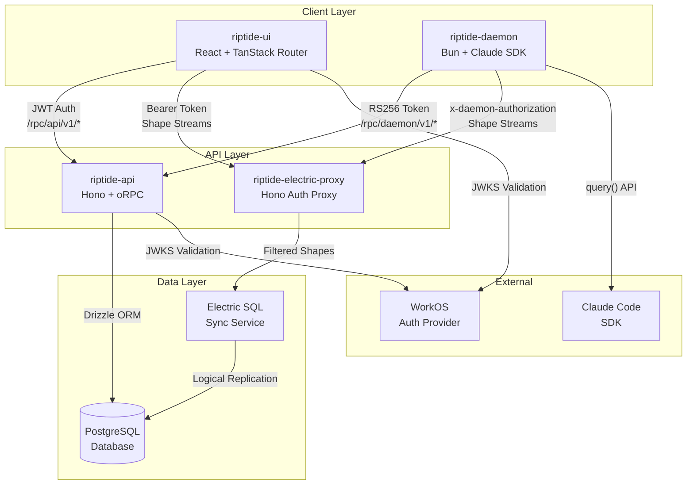
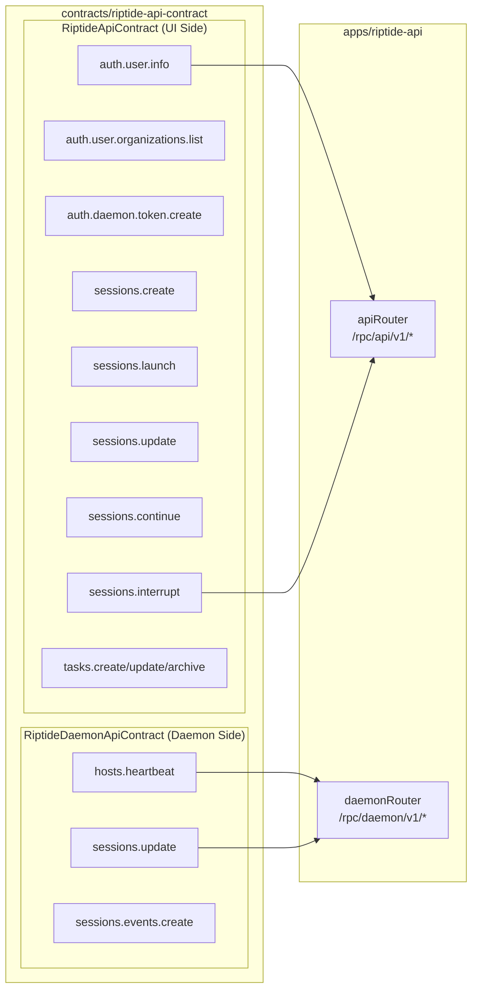
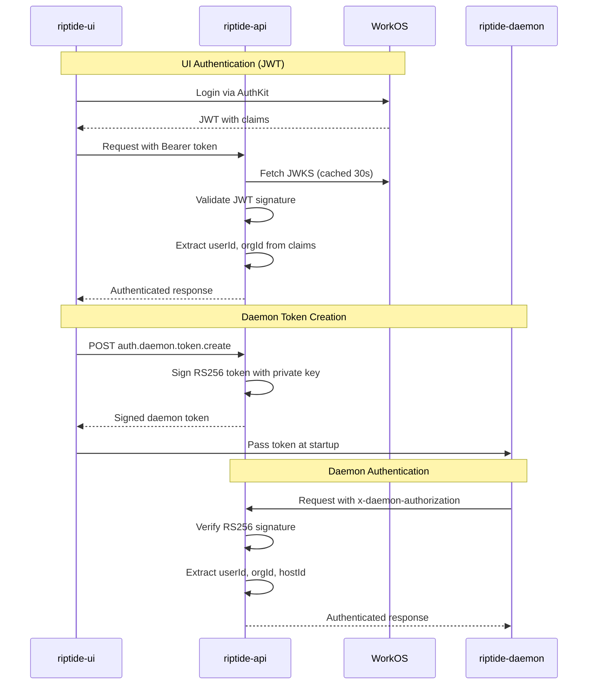
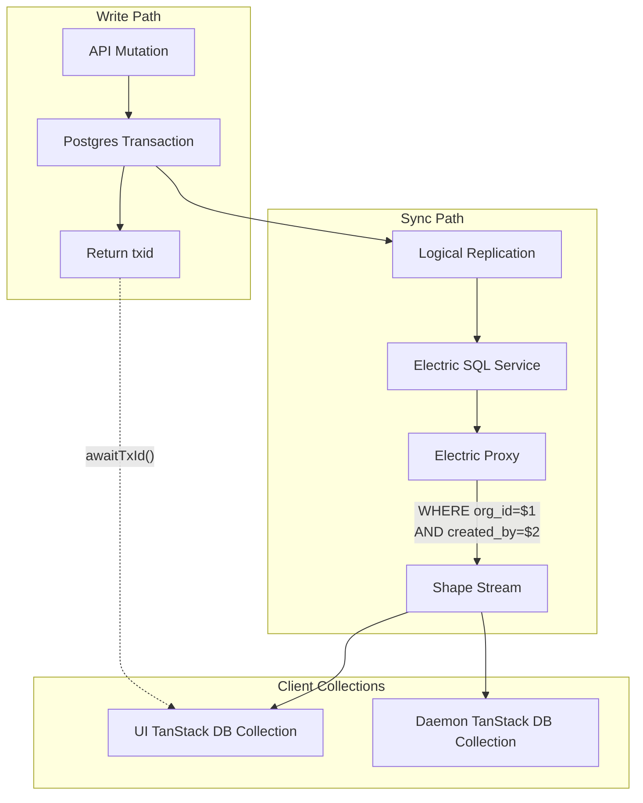
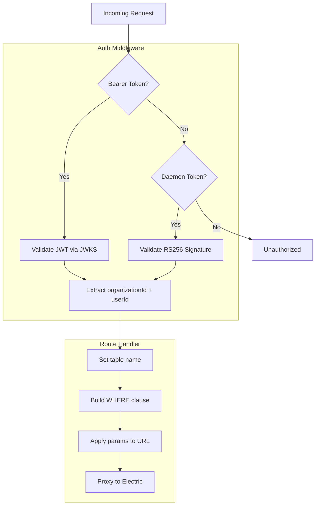
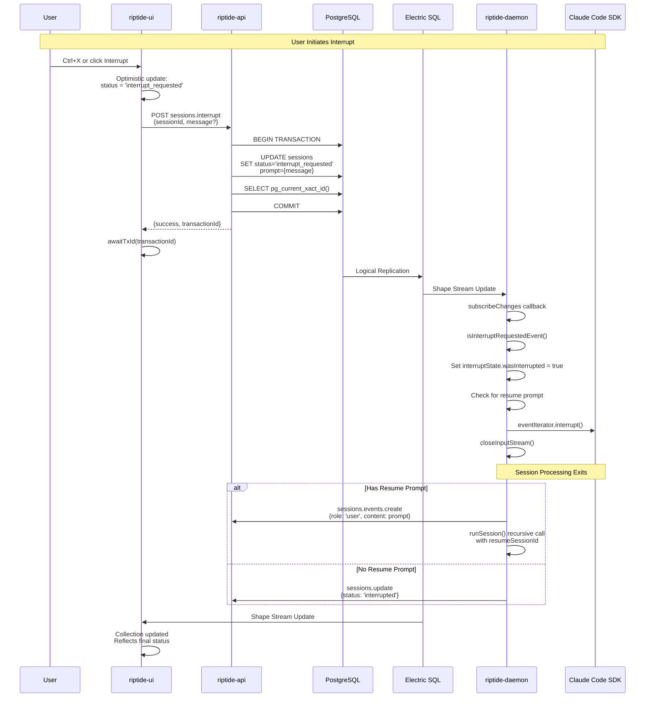
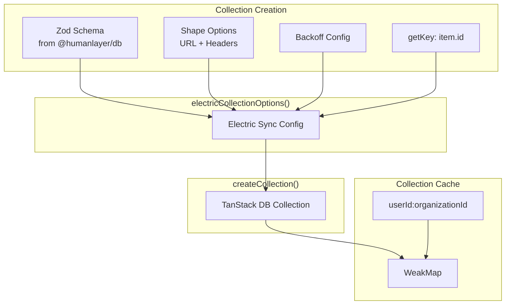
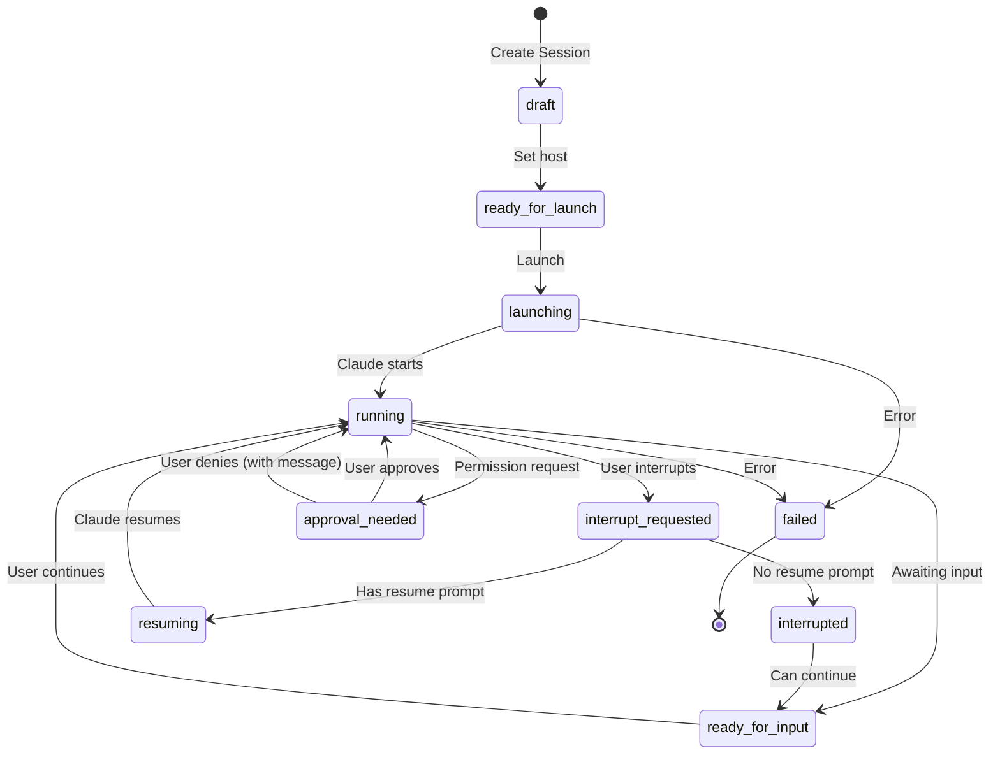

# Riptide Sync Architecture

This document describes the synchronization architecture for the Riptide system, including the API contracts, Electric SQL sync, and the interruption system.

## System Overview

## Contract Architecture

The `riptide-api-contract` package defines two separate oRPC contract hierarchies:

## Authentication Flow

## Electric SQL Sync Flow

## Electric Proxy Authorization

## Interruption System Flow

## TanStack DB Collection Pattern

## Session State Machine

## Data Flow Summary

| Component | Role | Auth | Data Direction |
|-----------|------|------|----------------|
| riptide-ui | User interface | JWT (WorkOS) | Reads via Electric, Writes via API |
| riptide-api | Business logic | JWT + RS256 | Reads/Writes Postgres |
| riptide-electric-proxy | Auth filter | JWT + RS256 | Proxies Electric with WHERE filters |
| Electric SQL | Sync engine | Secret token | Streams from Postgres |
| riptide-daemon | Session runner | RS256 token | Reads via Electric, Writes via API |
| PostgreSQL | Persistence | N/A | Source of truth |

## Key Integration Points

1. **Transaction IDs**: API returns Postgres `txid` so clients can wait for Electric sync completion
2. **Optimistic Updates**: UI updates local collection immediately, reverts on error
3. **Change Subscriptions**: Daemon uses `subscribeChanges()` to react to status updates
4. **Row-Level Security**: Electric proxy applies WHERE clauses based on auth context
5. **Dual Contracts**: Same API server, different auth and procedures for UI vs daemon
